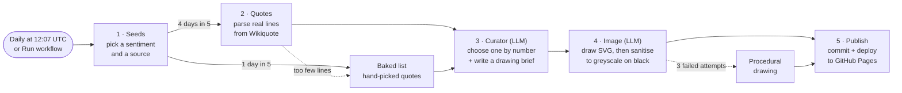

# pithy

[](https://github.com/alizaliz/pithy/actions/workflows/daily.yml)
[](https://alizaliz.github.io/pithy/)


**[alizaliz.github.io/pithy](https://alizaliz.github.io/pithy/)**

One aphorism (a maxim, proverb, or a quote that works as one) and one
white-on-black line drawing, once a day. Static site on GitHub Pages,
generated by a daily GitHub Actions job. No server, no database.



<details>
<summary><strong>Setup (one time)</strong></summary>

1. Push this folder to a new **public** repository (Actions and Pages are free for public repos).
2. Get a free LLM API key. The default is Google's Gemini API via its
   OpenAI-compatible endpoint: create a key at <https://aistudio.google.com/apikey>.
3. In the repo: **Settings → Secrets and variables → Actions**
   - Secret `LLM_API_KEY` = your key
   - Variables (optional): `LLM_MODEL` (default `gemini-3.8-flash`),
     `LLM_BASE_URL` (default Gemini's OpenAI endpoint). Any OpenAI-compatible
     provider works, e.g. Groq or OpenRouter.
4. **Settings → Pages → Build and deployment → Source: GitHub Actions**.
5. **Actions → pithy → Run workflow** to make the first entry. Until then the
   site shows a placeholder: pushes only redeploy, they don't generate.

</details>

<details>
<summary><strong>Daily schedule</strong></summary>

- The workflow runs at 12:07 UTC, about 01:00 in the timezone set in
  `config/seeds.toml` (default `Pacific/Auckland`). That timezone decides which
  date counts as "today".
- **Run workflow** makes today's entry if it doesn't exist yet. Tick *force*
  to regenerate it with a fresh pick (a different quote, sentiment and
  drawing), which is handy for testing. Each forced run adds a commit.
- Pushes to `main` run the tests and redeploy the site without generating.
- Scheduled runs can start 5–30 minutes late when GitHub is busy.
- If generation fails (e.g. the LLM is down), the site keeps the previous day.

</details>

<details>
<summary><strong>Using the data from other apps</strong></summary>

The site doubles as a read-only JSON API. Files are served with
`Access-Control-Allow-Origin: *`, so browsers can fetch them from any site, and
are cached for about 10 minutes.

| URL (under `https://<user>.github.io/pithy/`) | What |
|---|---|
| `data/today.json` | Today's entry |
| `data/YYYY-MM-DD.json` | The entry for a given day |
| `data/images/YYYY-MM-DD.svg` | The drawing (also given by `image` in the entry) |
| `data/history.json` | Every date with an entry |

An entry looks like:

```json
{
  "date": "2026-10-11",
  "text": "The sure conviction that we could if we wanted to is the reason so many good minds are idle.",
  "author": "Georg Christoph Lichtenberg",
  "work": null,
  "origin": "https://en.wikiquote.org/wiki/Georg_Christoph_Lichtenberg",
  "sentiment": "Motivational",
  "visual_brief": "An orthographic blueprint of a heavy flywheel ...",
  "alt": "Technical blueprint of a stationary flywheel with brake caliper and torque vectors",
  "image": "data/images/2026-10-11.svg",
  "image_method": "llm"
}
```

`image` is relative to the site root. `text` may contain `\n` line breaks
(passages). Use these Pages URLs rather than raw files from the repo: they only
change after a successful run and are what the site itself serves.

</details>

<details>
<summary><strong>How a day is made</strong></summary>

1. **Seeds**: picks a sentiment and a source from `seeds.toml` by weight, avoiding
   the last few days. About 1 day in 5 it uses the baked list instead.
2. **Quotes**: fetches the source's Wikiquote page and parses real lines,
   skipping "Disputed", "Misattributed" and "Quotes about" sections, dialogue,
   and anything over `max_chars` / `max_words` in `[selection]`. Quotes in their
   original language are replaced by the English translation listed under
   them, and trailing notes like "(1640)" or "(Hays translation)" are removed.
   On proverb pages, lines credited to a named person are skipped.
3. **Curator**: the LLM chooses the line that works best as a standalone
   aphorism, *by number*, and writes a drawing brief: an object or a scene that
   carries the quote's feeling (a lone probe passing the outer planets for
   loneliness), as a technical drawing or an industrial design sketch. It never
   writes the quote text itself, so nothing can be invented. Short passages of
   a few lines (a litany, a verse) are allowed when they stand on their own.
4. **Image**: the LLM draws the brief as SVG. The SVG is sanitised (no scripts or
   external refs), forced to greyscale on black, and rejected if too sparse. After
   three failed attempts, a procedural drawing is used so the page still updates.
5. **Publish**: writes the files, rebuilds `index.html`, commits, deploys to Pages.

</details>

<details>
<summary><strong>Repository layout</strong></summary>

```
config/seeds.toml          sentiments + sources (edit me)
config/baked_quotes.json   hand-picked fallback quotes (edit me)
generator/                 the daily job (Python, stdlib only)
  template.html            page template for site/index.html
site/                      what GitHub Pages serves
  index.html               rebuilt each day
  favicon.svg              white quotation mark on black
  data/YYYY-MM-DD.json     one entry per day (also today.json)
  data/images/*.svg        the drawings
  data/history.json        used quotes, so none repeat
tests/                     unit tests (run in CI)
.github/workflows/daily.yml
```

</details>

<details>
<summary><strong>Local use</strong></summary>

```bash
python -m unittest discover -s tests       # tests
python -m generator --offline              # no network: baked quote + procedural image
python -m generator --offline --date 2026-10-12
LLM_API_KEY=... python -m generator --force
python -m http.server -d site              # preview at http://localhost:8000
```

Requires Python 3.11+. No packages to install. Don't commit files generated by
local runs (`site/data/`, a rebuilt `site/index.html`); CI makes them.

On macOS with the python.org installer, Wikiquote requests may fail with
`CERTIFICATE_VERIFY_FAILED`; run *Install Certificates.command* from the Python
folder, or prefix commands with `SSL_CERT_FILE=/etc/ssl/cert.pem`.

</details>

<details>
<summary><strong>Notes</strong></summary>

- Wikiquote page titles in `seeds.toml` must match exactly (check the page URL).
- To add a passage from a book, put it in `config/baked_quotes.json` with `\n`
  between lines; the page keeps the line breaks. Wikiquote sources are limited
  by `max_chars` / `max_words`, so longer passages only come from the baked list.
- Keep quotes from in-copyright books (e.g. Dune) short and always attributed.

</details>
